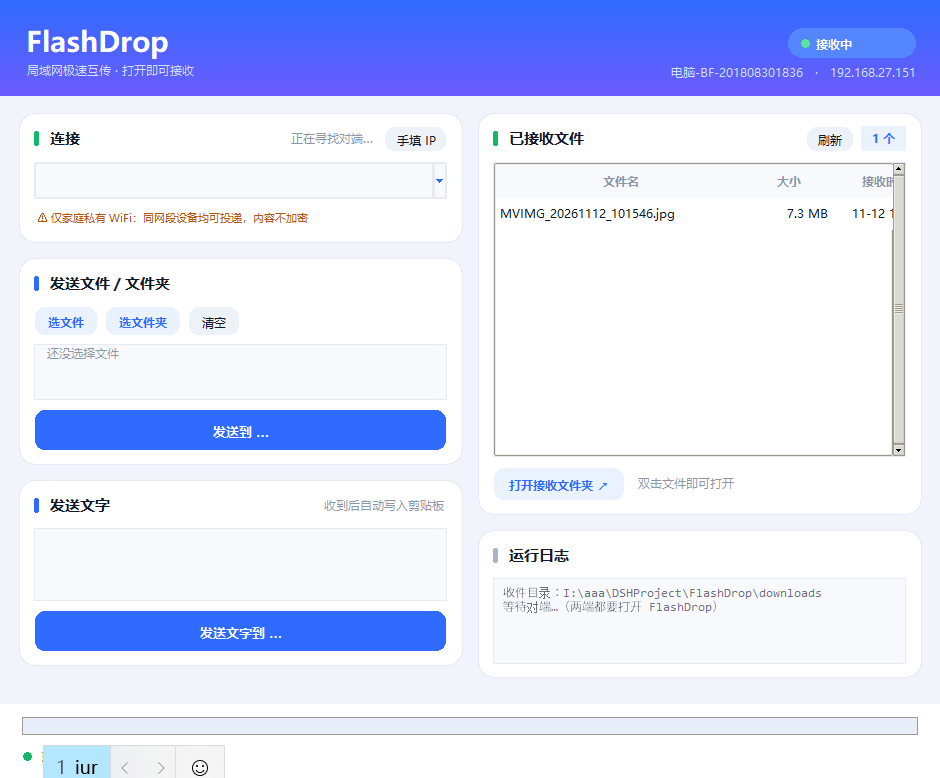

# FlashDrop

局域网内 Windows ⇄ Android 的文件、文件夹与文字极速互传。零账号、零云端、零第三方依赖。



## 特性

- **打开就能用**：两端连同一个 WiFi，打开程序即互相发现，选文件 → 点发送
- **拖拽发送**：从资源管理器把文件/文件夹拖进窗口即可加入发送列表，不用一层层点选
- **零账号零云端**：纯局域网直连，不经过任何服务器
- **文件 / 文件夹 / 文字**：文件夹保留目录结构落盘；文字自动写入接收端剪贴板
- **不覆盖任何文件**：同名自动加序号 `报告 (2).txt`
- **接收列表**：桌面与手机都能看到已收到的文件，双击直接打开，一键打开收件目录
- **依赖极少**：桌面端除一个可选的文件拖放库（`tkinterdnd2`，缺失时自动降级为按钮选文件）外只用标准库，手机端是原生 Java

## 快速开始

> 仓库里已经带好构建产物：**`FlashDrop.exe`（Windows，14MB）** 和 **`FlashDrop.apk`（Android，40KB）**。
> 只是要用、不想编译的话，clone 完直接双击 exe、把 apk 装到手机即可，**不需要 Python、不需要 Android SDK**。

### 最省事：直接用打包好的文件

```bash
git clone <仓库地址> FlashDrop
```

- **电脑**：双击 `FlashDrop.exe`（单文件，免安装、免 Python）
- **手机**：把 `FlashDrop.apk` 传到手机安装，或开 USB 调试后双击 `安装到手机.bat`

### 电脑端（Windows）其它方式

| 你的情况 | 怎么做 |
| --- | --- |
| 想改代码 / 用源码跑 | 有 Python 3.9+：双击 `启动.bat`；没有：先 `安装环境.bat` |
| 改了代码想重新打包 | 双击 `打包EXE.bat`，覆盖根目录的 `FlashDrop.exe` |

首次运行 Windows 会弹一次防火墙提示，**点允许**（否则手机发现不到电脑）。
`exe` 为 64 位 Windows 版本（x64 / ARM64 的 x64 兼容模式均可）。

### 手机端（Android）

- **USB 安装**：手机开启 USB 调试，双击 `安装到手机.bat`（会自动处理小米的「USB 安装提示」确认框）
- **手动安装**：把 `FlashDrop.apk` 传到手机，点击安装

首次打开需要允许：**本地网络**（Android 17 强制）、**通知**。

### 开始互传

1. 两台设备连接**同一个 WiFi**
2. 电脑打开 FlashDrop（exe 或 `启动.bat`），手机打开 App
3. 电脑端「对端」会自动出现手机（只有一个时自动选中）；选文件 → 点「发送到 xxx」
4. 手机端收到后，在「已接收文件」里点一下即可打开，或点「打开接收文件夹」

手机发给电脑同理：手机选文件 → 发送；电脑在右侧列表里查看。

## 使用要点

- **拖拽发送**：从资源管理器选中文件/文件夹，直接拖进 FlashDrop 窗口任意位置即可（拖到接收列表上也可以），会自动加入左侧待发送列表
- **多对端**：记住上一次成功投递的对端，按钮上直接写明目标，点一下可切换
- **发现不到**：点「手填 IP」，输入对端 IP（两端界面上都显示自己的 IP）
- **收件目录**：Windows 是程序目录下的 `downloads/`；Android 是 `Download/FlashDrop/`
- **同名不覆盖**：自动重命名为 `xxx (2)`，可以放心重复传
- **失败重试**：发送失败时状态栏右侧出现「重试上一次发送」

## 目录结构

```
FlashDrop/
├─ FlashDrop.exe           打包好的 Windows 单文件程序（直接双击用）
├─ FlashDrop.apk           打包好的 Android 安装包（直接安装）
├─ main.py                 桌面端入口（源码方式运行）
├─ flashdrop/              桌面端源码（界面 / 引擎 / 发现 / 落盘 / 协议）
├─ android/
│  ├─ src/                 手机端 Java 源码
│  ├─ res/                 资源（图标、字符串）
│  ├─ AndroidManifest.xml
│  └─ build.py             手工构建 APK（aapt2 + javac + d8 + apksigner）
├─ tools/
│  ├─ build_exe.py         打包单文件 exe
│  ├─ adb_install.py       自动处理小米安装确认框
│  └─ （jdk/ android-sdk/ python/ 等大件不入库，按需生成）
├─ tests/                  协议测试（桌面回环 + Java↔Python 跨语言）
├─ docs/
│  ├─ PROTOCOL.md          帧格式与握手
│  ├─ adr/                 架构决策记录
│  └─ 界面预览.png
├─ 启动.bat / 调试启动.bat  运行（调试版保留控制台日志）
├─ 安装环境.bat             准备 Python 环境
├─ 打包EXE.bat             生成 FlashDrop.exe
├─ android/构建APK.bat     重新构建手机端
└─ 安装到手机.bat           通过 adb 安装 / 升级
```

## 构建（可选，只是要用不必看这节）

仓库里两份产物都是能直接用的成品；只有改了源码才需要重新构建。

### 生成 exe

```bat
打包EXE.bat
```

PyInstaller 安装在 `tools/packenv`（不装全局），产物覆盖根目录的 `FlashDrop.exe`，约 14 MB（含文件拖放所需的原生库）、单文件、免 Python 运行。
首次打包若本机没有 Packenv 会自动创建（需要网络装 PyInstaller），建议先跑一次 `安装环境.bat`。

> 换了 exe 之后记得提交，另一台电脑 pull 下来就是新版。

### 重新构建 APK

需要 **JDK 17** 与 **Android SDK 36**，放到 `tools/jdk/` 和 `tools/android-sdk/`，然后双击：

```bat
android\构建APK.bat
```

签名用 `android/flashdrop.keystore`（自用调试签名，**不入库**）。换机器构建前先从旧机器复制这个文件，否则签名不同，覆盖安装会失败、需要先卸载。

## 设计与协议

- **发现**：UDP 47831 子网广播，两端各自广播 `hello`，收到即记录，超时移除
- **传输**：TCP 47832 单连接完成一次投递，帧格式 `MAGIC(4) + 头长(4) + JSON 头 + [数据 + CRC32] * N + ACK`
- **不加密**：见下方安全边界；用原生 socket 而非 HTTP，绕开移动端对明文 HTTP 的默认拦截

细节见 [docs/PROTOCOL.md](docs/PROTOCOL.md) 与 [docs/adr/](docs/adr/)。

## 安全边界

> 仅限**家庭私有 WiFi** 使用。

- 接收端**免确认**：同一 WiFi 内任何设备都能往收件目录写文件
- **不加密**：同一 WiFi 内可被嗅探到内容
- 界面上有常驻提示；不要在公共、办公、酒店等不可信网络使用

写入范围被严格限制在收件目录内（路径穿越会被拦截），且绝不覆盖已有文件。

## 常见问题

**手机发现不到电脑 / 电脑发现不到手机**
1. 确认在同一 WiFi（不是手机热点 + 电脑有线这种跨网段）
2. 首次运行点「允许」放行 Windows 防火墙（专用网络）
3. 路由器开了「AP 隔离 / 客户端隔离」时广播会被丢弃，改用「手填 IP」
4. 手机端确认「本地网络」权限已授予

**端口被占用**：47831 / 47832 被其它程序占用时启动会报错，关掉占用者或重启一次。

**手机收不到**：Android 会在 App 退到后台后限制网络，接收时请保持 App 在前台。

**Python 版本**：需要 3.9+ 且带 tkinter。Windows 官方安装包默认包含；Microsoft Store 版可能有问题，建议用 `安装环境.bat` 装项目私有 Python。

## 测试

```bash
python tests/smoke_test.py        # 桌面端回环：文件/文件夹/空目录/CRC/同名冲突/文字
python tests/cross_lang_test.py   # Java 与 Python 双向协议一致性（需要 tools/jdk）
```
